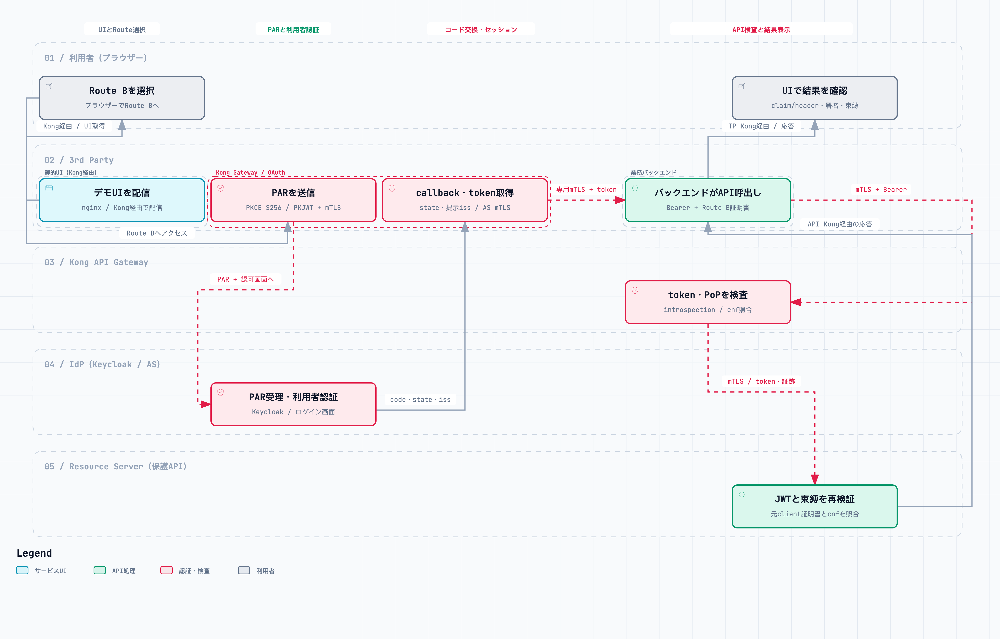

# デモのアーキテクチャと検証範囲

このデモは、3rd Partyサービスが利用者の認可を得てAPIを呼び出す構成で、Kong Gatewayの二つの役割を示します。3rd Party側ではOAuthクライアント、API提供者側ではResource Serverの入口として動作します。クライアント認証をRoute Aの`tls_client_auth`とRoute Bの`private_key_jwt`で比較し、両方でmTLSによるトークンの証明書束縛を検証します。

> **ソース・ローカル検証済み／実行受入前（2026-10-13）**: 3rd Partyバックエンドを追加したソース実装とManager独立のローカル検証は完了しました。図・資料はPR #30で先行反映し、コードは別Draft PR #31です。実Kong/Keycloakによる新経路の受入は未実施です。WP1～WP6の旧証跡を新経路の成功証跡に流用しません。

FAPI 2.0完全準拠、OIDF認定、本番運用への適合を主張しません。変更契約と新たな受入項目は[対応計画](docs/design/third-party-backend-change-plan.md)、設計判断は[ADR 0023](docs/decisions/0023-third-party-backend-separation.md)を参照してください。

## 全体構成

図をクリックするとPagesのインタラクティブ図を開きます。詳細は[Route Aのフロー図](https://picketfence-labs.github.io/diagrams/697f14e71ed9/)と[Route Bのフロー図](https://picketfence-labs.github.io/diagrams/31aaf1787cd8/)を参照してください。両図は同じ3rd Partyレーン内で静的UI、Kong Gateway、業務バックエンドを区別しています。図の状態表示は設計段階を示し、実行受入の結果を表しません。

| 構成要素 | 役割・責任 | デモでの配置 |
|---|---|---|
| 利用者・ブラウザー | Routeの選択、Keycloakでのログイン、検証結果の閲覧 | UI・業務要求の共通入口は`https://localhost:8443`。API提供者へ直接アクセスしない |
| 静的UIサービス | 画面とJavaScriptの配信 | `ui`（nginx）。TP Kongから内部HTTPで配信し、ブラウザー向け直接公開portを持たない |
| 3rd Partyバックエンド | 利用者の業務要求を受け、API提供者のAPIを呼び出して安全な結果を返す | `third-party-backend:9444`。TP Kong専用identityのmTLS入口。外向きはAPI側Kongへ直接接続 |
| 3rd PartyのKong Gateway | OAuth/OIDCクライアント。認可開始、PAR、コード交換、セッション、refresh、バックエンドへの認証済み要求、logout | `kong-third-party`。A/Bを別Route・Service・証明書・セッションに分離 |
| Keycloak / IdP | 利用者認証と、Authorization Serverとしての認可・トークン発行・introspection | `keycloak`、realm `fapi-demo`。ブラウザー向け`:8444`、内部向け`keycloak:8443` |
| Kong API Gateway | introspection、audience/scope、証明書束縛、入力ヘッダー境界の検査 | `kong-api:8443`。ブラウザーへ直接公開しない |
| Resource Server | 保護APIを模したPoP verifier。JWT署名とclaim、転送された元クライアント証明書との束縛を再検証 | `pop-verifier`。API Gatewayからのupstream mTLSだけを信頼 |

OAuth上のResource Serverの責任はAPI Gatewayと保護APIで分担します。入口の検査はGateway、追加のJWT署名・証跡検証は保護APIが担当します。PoP verifierは業務APIの代わりに検証結果を返すデモ用実装です。

二つのGatewayは独立したKonnect control planeで管理します。図の矢印は実行時の通信であり、Konnectの設定配信・テレメトリーは省略しています。目標構成はバックエンドを加えた6サービスで構成し、Kong Gateway 3.16.0.0と標準Keycloak 26.7.4を使用します。AS側の証明書を観測する改変Keycloakは隔離試験専用です。

## Route AとRoute B

| 比較項目 | Route A | Route B |
|---|---|---|
| 入口 | `/api/fapi/mtls` | `/api/fapi/pkj-mtls` |
| Keycloak client ID | `third-party-fapi-mtls` | `third-party-fapi-pkj-mtls` |
| クライアント認証 | `tls_client_auth` | `private_key_jwt`（PS256） |
| ASへの通信 | Route A証明書によるmTLS | Route B証明書によるmTLSとJWT assertionによる認証 |
| 送信者制約 | `cnf.x5t#S256`による証明書束縛 | 同左。JWT署名鍵とは別のTLS証明書へ束縛 |
| Kong標準機能 | 認可コード、PAR、PKCE、mTLSクライアント認証、セッション、refresh、logout | 認可コード、PAR、PKCE、セッション、refresh、PAR/revokeのPKJWT |
| デモ固有の補完 | AS送信境界のguard、metadata取得のmTLS | 左記に加え、token/refresh送信時のPKJWT signer delegateと各AS接続へのmTLS補完 |

Route Bでは署名鍵によるクライアント認証と、TLS証明書による送信者制約を別々に確認できます。assertionの`aud`はKeycloakのissuer文字列、`iss`と`sub`はclient ID、寿命は60秒以内とし、送信ごとに異なる`jti`を使います。ブラウザーから持ち込まれたassertionは拒否します。

カスタム実装は`fapi-client-auth-bridge`と`fapi-as-mtls-transport`です。固定版のOIDC内部APIに依存するため、Kong更新時は互換性と送信境界を再検証します。Route Aもフロー全体が標準プラグインだけで完結するわけではありません。詳細は[AS mTLS補完契約](docs/design/third-party-as-mtls-transport.md)を参照してください。

## 認証からAPI応答まで

1. 利用者がTP Kong経由で静的UIを取得し、UIでRouteを選びます。3rd PartyのKongがPARを送信し、ブラウザーをKeycloakへ遷移させます。認可コードフローとPKCE S256を使用します。
2. Keycloakで利用者が認証され、コードが固定callbackへ返ります。Kongは選択Routeのクライアント認証でコードを交換し、セッションを保持します。アクセストークンとrefresh tokenをUIのAPI応答や表示へ返しません。
3. 3rd PartyのKongは専用内部identityのmTLSでバックエンドへ要求を転送し、セッションに対応するアクセストークンを渡します。バックエンドは固定内部pathからA/Bを選択し、AS通信で使ったものと同じRoute証明書と`Authorization: Bearer`でAPI側Kongを呼び出します。バックエンドの外向き要求をTP Kongへ戻しません。
4. API Gatewayは専用client `api-gateway-introspection`でKeycloakへmTLS introspectionを行います。`active`、issuer、audience `fapi-demo-api`、scope `openid`とPoPを確認します。introspection cacheは無効です。
5. API Gatewayは呼出し元の証跡用ヘッダーを除去し、認証済みclaimからヘッダーを再生成します。元クライアント証明書を検証用に転送し、別のupstream用証明書でPoP verifierへmTLS接続します。
6. PoP verifierはAPI GatewayのTLS identityを確認し、JWTのPS256署名・issuer・audience・時刻・scopeと、元クライアント証明書に対する`cnf.x5t#S256`の一致を再検証します。結果はAPI側Kong、バックエンド、TP Kongを通ってUIへ戻ります。バックエンドは許可項目だけを返し、UIはclaim/header、束縛結果、thumbprintの先頭12文字だけを表示します。

期限更新はKongのrefresh処理を使い、新しいrefresh tokenが返れば保存します。logoutではtoken revocation、Kongセッション破棄、KeycloakのRP-Initiated Logoutを扱います。logoutのHTTP成功は個別トークンの失効反映時間を保証する証拠とは扱いません。

既存OIDC設定の`login_tokens: [id_token]`は、ログイン後のUI URL fragmentへIDトークンを返します。UIのスクリプトはfragmentをURLから除去し、IDトークンを表示・API送信・利用者判定に使いません。ブラウザーへの全トークン非返却は達成しておらず、アクセストークン／refresh tokenの非露出と区別します。今回のバックエンド分離ではこの既存設定を維持します。図のAPI通信で渡すtokenはアクセストークンを指します。

## 証明書と信頼境界

| 接続 | 使用するidentity | 検証の意味 |
|---|---|---|
| TP Kong → AS | Route A/BそれぞれのTLS証明書 | Aでは認証と束縛、BではmTLS接続と束縛。Bの認証は別のJWT署名鍵 |
| TP Kong → バックエンド | 内部hop専用クライアント証明書 | バックエンドが専用Kong identityを照合。A/Bのtoken束縛には使用しない |
| metadata/JWKS取得 → AS | metadata専用証明書 | 通信のmTLS。OAuth client identityやトークン束縛には使用しない |
| TPバックエンド → API Gateway | トークンに束縛されたRoute証明書 | TLSで提示されたleafと`cnf.x5t#S256`の一致 |
| API Gateway → AS | introspection専用証明書 | API側の検査用client認証 |
| API Gateway → 保護API | upstream専用証明書 | 転送証跡を受け取れるGatewayのidentity。元3rd Partyの証明書とは別 |

Route A/BのTLS秘密鍵は同じ3rd PartyのOAuthクライアント信頼領域内でKongとバックエンドが共有します。KongはAS接続、バックエンドは外部API接続に使います。保持箇所が増えるため、必要な鍵だけを読み取り専用でmountします。JWT署名用のRoute B秘密JWK、metadata鍵、refresh token、セッションCookieはバックエンドへ渡しません。内部hopの専用証明書とA/B証明書を置き換えると、tokenの束縛先が異なるためAPI接続が成立しません。

API Gatewayの`tls-handshake-modifier`は証明書を要求しますが、CA chainの検証は行いません。標準OIDCの`proof_of_possession_mtls: strict`でトークンとの一致を確認します。CA外の自己署名証明書を一律拒否する設計ではありません。CA chainを検証するなら束縛検査とは別のポリシーが必要です。[RFC 8705 §6.2](https://www.rfc-editor.org/rfc/rfc8705.html#section-6.2)

保護APIが直接観測するTLS peerはAPI Gatewayです。元クライアント証明書はGatewayの転送証跡として照合します。検証のため`Authorization`は保護APIまで転送し、Cookieと内部assertion用ヘッダーは除去します。証明書本体やtokenを応答・ログに出しません。

## 今回扱うFAPI要件

対象は[FAPI 2.0 Security Profile Final](https://openid.net/specs/fapi-security-profile-2_0-final.html)の主要なクライアント・Resource Server制御です。TLS、強いクライアント認証、認可コード/PAR/PKCE、送信者制約、API側の検査を一連のフローとして実演します。mTLSとDPoPは送信者制約の選択肢であり、このデモはmTLSを採用します。JAR/JARM等のMessage Signingは別の追加仕様として対象外です。

以下は変更前の実装・検証を基準に、目標構成で維持するFAPI制御をまとめたものです。表中の「検証済み」は旧構成での結果です。新しい内部mTLS、バックエンドの外向き証明書、refresh後のtoken引継ぎ、UI共通入口は新経路で再検証します。規範条項と対応の詳細は[詳細対応表](docs/design/third-party-fapi2-conformance.md)、試験条件は[WP5受入表](docs/design/third-party-wp5-acceptance.md)と[WP6受入表](docs/design/third-party-wp6-acceptance.md)を参照してください。

| 制御・関連ID | Route | 現在の対応 | Kong・ASでの担当と検証範囲 |
|---|---|---|---|
| TLS・証明書検証（C-01、R-05） | A/B | 対応・対象範囲で検証済み | 開発CAを固定しAS/API/upstreamの検証を有効化。API入口の`modern`はTLS 1.3-onlyで拒否対照も検証。他の全接続がTLS 1.3-onlyという意味ではない |
| クライアント認証（C-05） | A/B別 | 対応・検証済み | Aは標準mTLS認証。Bは標準PKJWTとbridge。AS側peer観測と署名条件を隔離試験で確認 |
| 証明書束縛（C-04、R-04） | A/B | 対応・検証済み | Keycloakが`cnf`を発行。API GatewayのPoP検査と保護APIの追加検証。証明書なし・不一致等の負例を確認 |
| 認可コード・PAR・PKCE（C-12～14） | A/B | 動作確認済み。BのPARに仕様差分あり | 標準OIDCとKeycloak policy。PAR201、コード交換、S256等を確認。challengeの毎回の新規性を含む全組合せは未網羅 |
| assertionの暗号・claim（C-08、18、19） | B | 対応・検証済み | PS256、公開JWK登録、issuer文字列aud、短命assertion。実送信で検査。ID tokenもPS256 |
| refresh・rotation（C-09） | A/B | 対応・隔離試験済み | 標準OIDC。2回の更新と新refresh token使用を直結試験で確認 |
| header限定のtoken（C-06、R-01） | A/B | 対応・検証済み | Bearer headerで送信しAPIはheaderだけから受理。query/body持込みを拒否 |
| active・audience・scope・エラー（R-02、03） | A/B | 対応・対象負例を検証済み | 標準introspection/OIDC、専用audience、cache無効。隔離WP3は37/37。個別失効SLAは未検証 |
| redirect・応答issuer（C-07、15） | A/B | 部分対応 | 固定URIと提示された`iss`不一致拒否。`iss`欠落拒否は未対応 |
| 偽装防止・表示制限 | A/B | デモ追加制御・検証済み | pre-function、認証済みclaim/証明書ヘッダーの再生成、UI allowlist。FAPI本体の独立条項と同一視しない |

## Route Aの詳細：mTLSクライアント認証と証明書束縛

図をクリックするとPagesで拡大・経路確認ができます。Route Aは、TLS証明書でOAuthクライアントを認証する`tls_client_auth`と、同じ証明書に束縛したアクセストークンを組み合わせます。クライアント認証は「どの3rd Partyへトークンを発行するか」、証明書束縛は「そのトークンを誰がAPIで使えるか」を検査します。

1. 利用者がサービスUIでRoute Aを選ぶと、3rd PartyのKongが`third-party-fapi-mtls`としてPARを送信します。Route A証明書でASへmTLS接続し、PKCE S256のchallengeを含めて認可要求を登録します。ブラウザーはKeycloakのログイン画面へ移動します。
2. 認証後のcallbackで、Kongはstateと提示された`iss`を確認します。続いてRoute A証明書によるクライアント認証とPKCE verifierでコードを交換します。Keycloakは同証明書のthumbprintを`cnf.x5t#S256`へ設定したトークンを発行します。
3. Kongはトークンをセッションで管理し、専用mTLSでバックエンドの`/evidence/route-a`へ渡します。バックエンドがBearerヘッダーとRoute A証明書によるmTLSでAPI側Kongを呼び出します。ブラウザーはアクセストークンを直接扱いません。
4. API Gatewayは専用クライアントによるintrospectionでactive・issuer・audience・scopeを検査し、提示された証明書と`cnf`を照合します。保護APIへの接続では別のupstream証明書を使用し、元クライアント証明書の証跡を転送します。
5. Resource ServerはJWT署名とclaim、転送された証明書との束縛を再検証します。結果はAPI側Kongからバックエンド、TP Kongを経由してブラウザーへ戻り、UIがclaim/headerの一致、署名、束縛の検証結果を表示します。

認可コード、PAR、PKCE、mTLSクライアント認証、セッションとrefreshは標準OIDCを中心に実行します。`fapi-as-mtls-transport`はASへの送信境界を検査し、metadata/JWKS取得には専用証明書を使います。Route Aの認証・トークン束縛用証明書とmetadata専用証明書は役割が異なります。

変更前のデモではRoute Aの正常フローとAPI側の証明書なし・束縛不一致等の拒否を確認しています。新経路は実装・受入前です。callbackの`iss`欠落拒否、追加の認可開始CSRF防御、個別トークン失効SLAは未対応・未検証の項目として残ります。

## Route Bの詳細：private_key_jwtとmTLS証明書束縛

図をクリックするとPagesで拡大・経路確認ができます。Route Bは、JWT assertionでOAuthクライアントを認証する`private_key_jwt`と、TLS証明書に束縛したアクセストークンを組み合わせます。JWT署名鍵とmTLS証明書の鍵を分離し、認証とAPI呼出し時の送信者制約をそれぞれ検証します。

1. 利用者がRoute Bを選ぶと、3rd PartyのKongが`third-party-fapi-pkj-mtls`としてPARを送信します。標準OIDCがPS256のJWT assertionを作成し、transport補完によりRoute B証明書でASへmTLS接続します。認可コードフローとPKCE S256、Keycloakの利用者認証はRoute Aと共通です。
2. callbackのstateと提示された`iss`を確認した後、`fapi-client-auth-bridge`がtoken送信時のPKJWT署名を担当します。assertionの`iss`/`sub`はclient ID、`aud`はKeycloakのissuer文字列、寿命は60秒以内、`jti`は送信ごとに異なる値です。ASへの接続にはRoute B証明書も提示します。
3. Keycloakは登録済み公開JWKでassertionを検証してクライアントを認証し、アクセストークンをRoute BのTLS証明書へ束縛します。`cnf.x5t#S256`が指すのはJWT署名鍵ではなく、このTLS証明書です。
4. Kongは専用mTLSでバックエンドの`/evidence/route-b`へtokenを渡します。バックエンドがBearerヘッダーとRoute B証明書によるmTLSでAPI側Kongを呼び出します。結果はバックエンドとTP Kongを通ってUIへ戻ります。API Gatewayのintrospection・claim・PoP検査とResource ServerのJWT・束縛再検証はRoute Aと同じ方針です。
5. 期限更新でもbridgeが送信時のPKJWT署名を担います。PARとrevocationのPKJWTは標準OIDCを使い、`fapi-as-mtls-transport`がAS接続へのmTLS補完と送信境界の検査を担当します。UIではRoute Bのclaim/header、署名と束縛結果を確認します。

この分担はKong Gateway 3.16.0.0の固定実装に合わせたものです。bridgeは標準フローのtoken/refresh署名を補完し、ブラウザーから持ち込まれたassertionを使用しません。Kongの更新時には内部APIとの互換性と、標準処理・bridge・transportの組合せを再検証します。

変更前のRoute Bは正常動作を確認済みですが、新経路は実装・受入前です。また、固定版の標準PAR処理がformの`client_id`を省略する仕様差分を残します。PAR成功をRFC 9126への完全適合とは扱いません。Route Aと共通する`iss`欠落、開始CSRF、失効SLA等の差分も、次の一覧に示します。

## 未対応・未検証項目と追加設計

| 項目 | Route | 現状と制約 | Kongで対応する場合の方針 |
|---|---|---|---|
| PAR formの`client_id`（C-13） | B | 固定版PKJWT分岐で省略。PAR201は確認済みだが[RFC 9126 §2.1](https://www.rfc-editor.org/rfc/rfc9126.html#section-2.1)との差分が残る | 対応版への更新、または仕様どおりのPARを作る補完を別設計・再検証。今回は標準送信本文を変更しない（[ADR 0019](docs/decisions/0019-wp5-stock-claim-fixture-boundaries.md)） |
| discoveryとrevocation URL（C-03、10） | A/B | 公開issuerと内部AS originを分離。Keycloak 26.7.4に既知差分がありMETA-02完全一致ではない | DNS/到達経路・Keycloak公開URLの統一等でmetadataを正しく利用できる配置を再設計（[ADR 0021](docs/decisions/0021-wp5-revocation-metadata-gap.md)） |
| `iss`欠落拒否（C-15） | A/B | ASがissuer識別に対応する場合に必要な欠落検査を標準実装が行わない | callback限定の`pre-function`等で欠落/重複/不一致を拒否し正当対照を追加。[RFC 9207](https://www.rfc-editor.org/rfc/rfc9207.html)に沿って設計 |
| 認可開始CSRF（C-11） | A/B | 明示ボタン操作とstate/PKCEはあるが開始CSRF防御の充足は未主張 | CSRF tokenを検証する専用開始endpointやBFFとKongを連携。callbackとは別に設計 |
| 個別失効・反映SLA（R-02） | A/B | active検査・logoutは確認済み。個別token失効保証と時間上限は未検証 | ASの失効単位を確定しcache方針と再検査間隔を設定。revoke後のAPI拒否と時間を測定 |
| browser TLS stripping・信頼環境 | A/B | 開発CA・localhost環境。認証後のHTTPS結果画面はCA信頼エラーで未確認 | 信頼済み証明書、HTTPS強制、HSTS等を構成しIdP/UIを含め実browserで検証 |
| DPoP（C-20） | A/B | mTLSを採用したため未実装。両方式の実装は今回の必須条件ではない | [標準OIDCのRS側DPoP検証](https://developer.konghq.com/plugins/openid-connect/#demonstrating-proof-of-possession-dpop)に加えclient側proof生成・鍵・nonce/replayを別設計 |
| 本番運用・網羅的適合試験 | A/B | DNSSEC、HA、鍵更新運用、監査保持、全worker/非同期経路の負例、全FAPI条項試験は範囲外 | Gateway、AS、アプリ、PKI、運用の責任分担と試験計画を作成。デモ受入を本番認定へ流用しない |

## 検証証跡と再現構成

変更前の通常Route A/Bの認証、API200、claim/header、束縛、署名、偽装拒否、logoutと、既存2 control planeを使うclean checkout再現を受入済みです。これらはTP KongからAPI側Kongへ直接転送する旧構成の証跡です。新構成では専用内部mTLS identity、ASのA/B identity維持、バックエンドの同一証明書によるAPI呼出し、refresh/logout、同時A/B分離、入口のreadinessを再確認します。AS直結試験、relayを介した署名検査、AS単体TLS観測は異なる検証層です。relayの成功だけでKong→AS直結mTLSを証明したとは扱いません。失敗試行も[検証履歴](docs/design/verification-history.md)に保持します。

変更前の受入構成をApple Siliconで再現する場合は、主Composeと[docker-compose.demo-native.yml](docker-compose.demo-native.yml)を併用します。overrideはAPI/verifierの受入済み公開amd64 imageと、3rd Party用の固定native arm64 base＋ソースの読み取り専用mountを指定します。buildを無効にして旧受入構成を再現するため必要です。新バックエンドを含むCompose/native構成と起動手順はコード側の変更で整備し、別途受入します。

起動手順とGit外入力は[README](README.md)、契約とADRへの入口は[設計資料一覧](docs/design/README.md)にまとめています。トークン、鍵、証明書本体、Terraform state、一次receiptはGitに収録しません。
