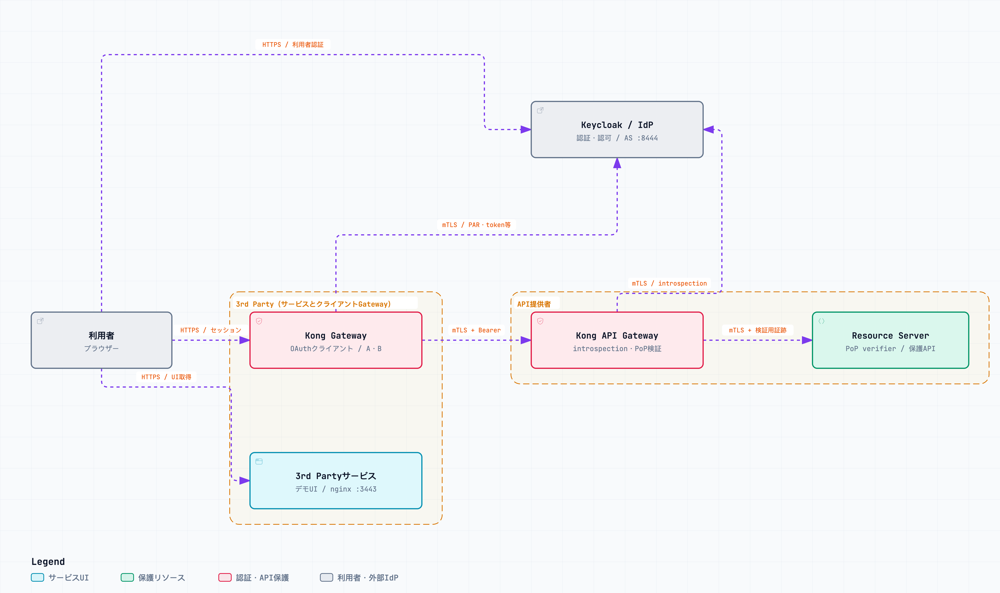
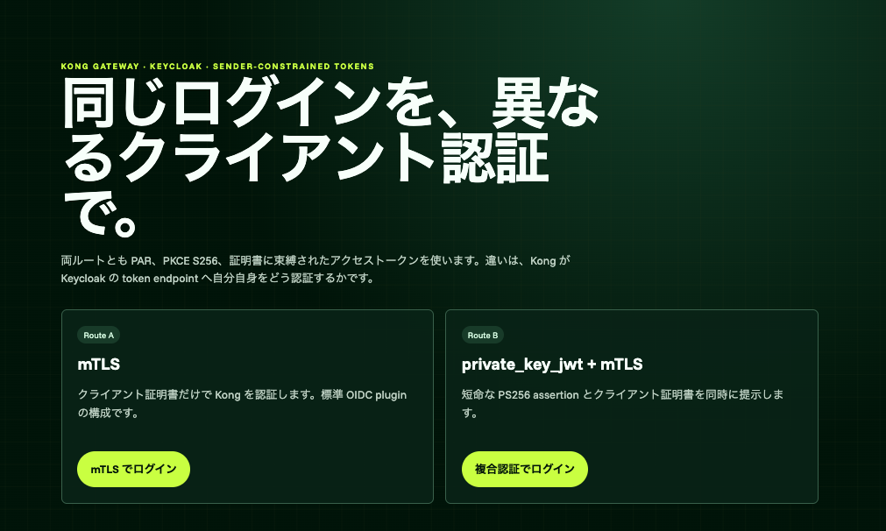
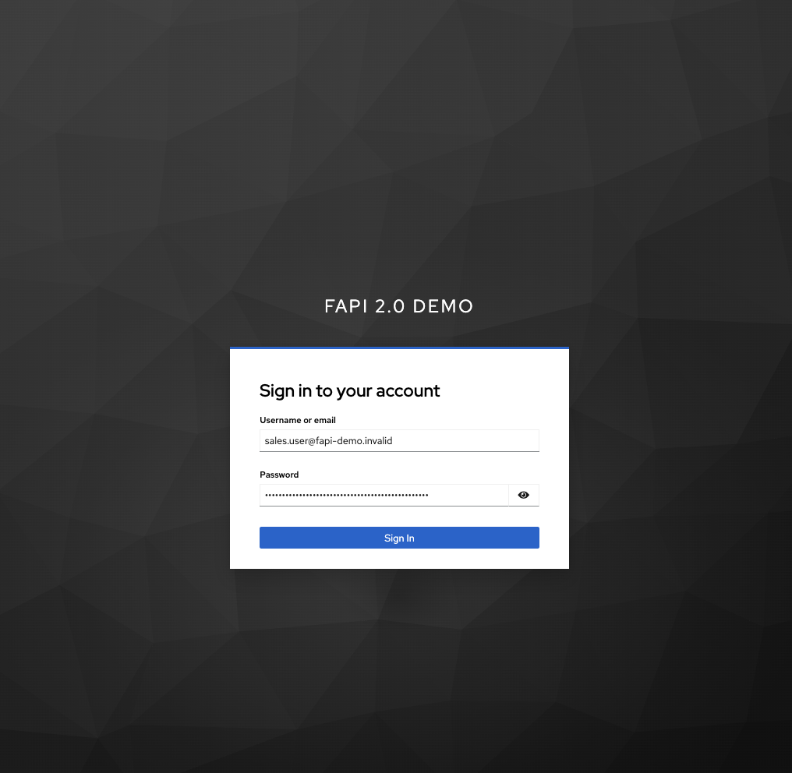

# Keycloak FAPI 2.0 クライアント認証デモ

3rd Party側とAPI提供者側にKong Gateway 3.16を配置し、同じKeycloak realmに対する二つのOAuthクライアント認証方式を比較するローカルデモです。全体構成、FAPI要件への対応と制約は[ARCHITECTURE.md](ARCHITECTURE.md)を参照してください。

| ルート | パス | token endpoint のクライアント認証 |
| --- | --- | --- |
| Route A | `/api/fapi/mtls` | `tls_client_auth` |
| Route B | `/api/fapi/pkj-mtls` | `private_key_jwt`（PS256）+ mTLS |

両ルートで PAR、PKCE S256、短命な認可コード、証明書に束縛されたアクセストークンを要求します。Upstream の PoP verifier は JWT の署名・issuer・audience・時刻・scope、`cnf.x5t#S256` と API Gateway が転送した3rd Partyのclient certificateとの一致を確認します。UpstreamへのTLS peerはAPI Gatewayとして別に検証します。

> このリポジトリは FAPI 2.0 の学習・比較用デモです。認定試験への適合を主張するものではありません。

## バックエンド分離の承認済み設計

> **ソース・ローカル検証済み／実行受入前（2026-10-13）**: バックエンドを加えた6サービスを実装しました。Manager独立のローカル検証は成功し、実Kong/Keycloakでの新経路は未受入です。図・資料はPR #30で先行してmainへ反映、コードは別Draft PR #31でレビューします。WP1～WP6の旧受入を新経路の成功証跡に流用しません。

TP設定は承認済みの残6操作を同期し、実差分0へ収束しました。隔離環境の起動後、IdPの限定更新に伴う非対象フィールドの比較で停止しています。新経路の受入は未完了です。[現在の状態と再開条件](docs/design/third-party-backend-runtime.md#tp設定のプレビューと今回専用承認)を確認してください。

この実装は、UI配信と業務API処理を分離します。ブラウザーの共通入口はTP Kongです。OAuthとセッションをKongが管理し、API提供者への呼出しをバックエンドが担当します。

```text
UI:   ブラウザー → TP Kong → 静的UIサービス
API:  ブラウザー → TP Kong → TPバックエンド → API側Kong → Resource Server
応答: Resource Server → API側Kong → TPバックエンド → TP Kong → ブラウザー
```

[](https://picketfence-labs.github.io/diagrams/16c30c21e271/)

[Route Aの変更後フロー](https://picketfence-labs.github.io/diagrams/697f14e71ed9/) / [Route Bの変更後フロー](https://picketfence-labs.github.io/diagrams/31aaf1787cd8/)。内部mTLSとA/B証明書共有の境界は[ARCHITECTURE](ARCHITECTURE.md)、実装・受入契約は[対応計画](docs/design/third-party-backend-change-plan.md)を参照してください。

## 検証状態とローカル検証

変更前のWP1～WP6とEpic #6は承認範囲で受入済み・closedです。通常Route A/Bの認証、API応答、証明書binding、claim/header、偽装header拒否、logoutは確認済みです。WP6もUI表示、reset/switch、既存2 CPを使うclean checkout再現の受入確認を完了しました。検証層と未実行項目は[WP6受入表](docs/design/third-party-wp6-acceptance.md)、WP5のP0/P1/Dと承認済み未網羅範囲は[WP5受入表](docs/design/third-party-wp5-acceptance.md)を参照してください。

このデモは本番FAPI 2.0完全準拠、認定、production readinessを主張しません。Route BのPKJWT PARにおけるform `client_id`省略はRFC 9126の既知gapとして開示します。stock本文は変更しません。Keycloak 26.7.4のrevocation metadata URL差分は[ADR 0021](docs/decisions/0021-wp5-revocation-metadata-gap.md)のとおり既知差分として記録し、META-02完全一致とは扱いません。

Apple Siliconでは[ローカルCompose override](docker-compose.demo-native.yml)を使います。API Gatewayとverifierは公開amd64 imageを使い、third-party Data PlaneはKong Gateway 3.16.0.0のnative arm64 baseから起動して、このcheckoutのtransport/bridge sourceをread-onlyでmountします。バックエンドは`python:3.13-alpine`をUID/GID1000で使い、app.pyをread-only mountします。overrideはimageをbuildせず、source treeだけを反映します。バックエンドのGHCR imageは未公開です。

開発依存を入れ、credential-freeの静的検証を行います。

```bash
python3.13 -m venv .generated/dev-venv
source .generated/dev-venv/bin/activate
python -m pip install --requirement requirements-dev.txt
make validate
make test
node tests/test_wp6_ui.js
```

## 実装構成

1. TP Kongを共通入口にし、静的UIを内部nginxから配信します。ブラウザーはTP Kongへ認証と業務要求を送ります。
2. 3rd PartyのKongがKeycloakでPAR、認可コード交換、セッション、refresh、logoutを扱います。
3. Route AはmTLS認証、Route BはPKJWT認証とmTLSを組み合わせます。AS通信の不足部分をbridge/transportプラグインで補完します。
4. TP Kong専用identityのmTLS要求をバックエンドが受け、利用者tokenとA/B証明書でAPI側Kongの固定APIを呼びます。
5. API側のKongがintrospectionとPoPを検査し、認証済みclaimからヘッダーを生成します。
6. PoP verifierがJWT署名・claimと元クライアント証明書への束縛を再検証します。応答はバックエンドの許可項目へ限定してKong経由でUIへ返します。
7. 二つのGatewayを別のKonnect control planeで管理し、TerraformとdecKで構成を管理します。

秘密鍵、パスワード、セッション secret、生成済み realm は `.generated/` に保存され、Git の対象外です。

## 前提条件

- Terraform 1.11 以降
- decK 1.53 以降
- `!reset`をサポートするDocker Compose（Compose 5.2.0で確認済み。[mergeの説明](https://docs.docker.com/reference/compose-file/merge/#reset-value)を参照）
- Python 3.13（受入・CIで検証した版）とOpenSSL
- 既存2 Control Planeを読み取れるKonnect token
- Apple Siliconまたはarm64端末（third-party Data Planeはnative arm64で起動）
- Node.js（UI単体検査だけに使用。runtime依存ではありません）

Data plane は Konnect control plane から Enterprise ライセンスを取得します。ローカルの `KONG_LICENSE_DATA` は不要です。

## バックエンド分離構成を準備する

[準備・適用・受入の手順](docs/design/third-party-backend-runtime.md)に、既存素材の保全、新2identity、8ファイルmount、schema2承認、native実行と未確認項目をまとめています。新構成のclean checkout受入は未実施です。[変更前の再現手順](https://github.com/picketfence-labs/konnect-oidc-fapi2-keycloak/blob/933a51a/README.md#clean-checkoutから既存デモを再現する)は履歴であり、現在のcheckoutの起動手順として実行しません。

適用前に、対象TP Control Planeの実diff、image・Compose project・port・mount・DBの扱いを具体的なプレビューで確認します。既存CA/A/B/PKJWT/セッション素材を保持し、新しいBackend serverと内部hopのidentityだけを加えます。旧承認schema1/additive11は現在のTP runtimeを許可できません。

```bash
export COMPOSE_FILE=docker-compose.yml:docker-compose.demo-native.yml
docker compose --env-file .env --env-file .generated/runtime.env --profile gateway --profile demo config --quiet
GATEWAY=third-party STAGE=runtime make deck-diff
```

上記は設定検証とread-only差分です。外部CPへの接続・credential利用を許可された環境で実行し、生のsecretやdiff本文を共有しません。人がプレビューを確認するまでsync/pull/up/IdP更新は行いません。承認後の入口は `https://localhost:8443`、Keycloakは `https://localhost:8444` です。旧UIの3000/3443は公開しません。supervisorはTP全workerとバックエンドのreadinessを確認した後に8443を開き、停止・構成変更時に入口を閉じます。`make up`の既存の閉鎖guardは維持しています。

### Routeとデモユーザーを切り替える

同じbrowser profileを使い、Route Aでsales demo userとしてloginし、claim/headerを確認してからRoute Aのlogoutを選びます。Route Bへ進み、engineering demo userで新しくloginして同じ確認を行い、Route Bのlogoutを選びます。A→B→A→Bの順で繰り返し、毎回Keycloakのlogin formが表示されてから資格情報を入力します。結果画面ではRoute、azpから決まる認証方式、department、claim/header、binding、thumbprint先頭12文字を確認します。

logout後もKeycloakが既存SSO sessionを使ってlogin formを省く場合は、対象demo userだけをresetします。Keycloak Admin Consoleの`fapi-demo` realmで`Users`から対象ユーザーを開き、`Sessions`の`Logout all sessions`を実行してください。影響を受けるbrowserのlocalhost site cookieも消してから同じflowをやり直します。realm全体や別の利用者をresetしません。HTTPS警告を無視して先へ進まず、開発CAが信頼されていなければそのbrowser evidenceは未実行として記録します。

新しい隔離Keycloak環境を作る場合にだけ`make generate-dev-assets`を使い、空の`keycloak/data/`へrealmをimportします。既存DBを再利用する場合、生成し直したpassword/realmと混在させません。`make render-runtime`には対応するTerraform output stateが必要です。

[](https://picketfence-labs.github.io/diagrams/31aaf1787cd8/)

*変更前のデモ開始画面の例。画像をクリックすると Route B のインタラクティブ workflow を開きます。*

[](https://picketfence-labs.github.io/diagrams/697f14e71ed9/)

*変更前のKeycloak認証画面の例。画像をクリックすると Route A のインタラクティブ workflow を開きます。*

## 新経路で確認すること（実行受入は未実施）

- Route A は `tls_client_auth` と表示される。
- Route B は `private_key_jwt` と表示される。
- `binding_verified` と署名再検証が成功する。
- UIのthumbprintは3rd Partyバックエンド→API Gateway間のtoken bindingとclient certificateを表し、それぞれ先頭12文字だけを表示する。
- デモユーザーに応じて `department` と `logical_route` が変わる。
- `department_header` と `logical_route_header` が署名済み claim と一致し、UI に「claim とヘッダー: 一致」と表示される。
- UI の偽装テストで送った `X-Demo-*` ヘッダーが、署名済み claim の値を上書きしない。
- Route A/Bのlogout後は同じcookie jarからfresh loginし、旧Route sessionを再利用できない。

## 変更前の実装と受入範囲

Route Aはstock OIDCの`tls_client_auth`を使います。Route Bはstock OIDCのPKJWTとmTLS transportへ既存bridge/custom transportを組み合わせます。API側はstock Resource Server設定と追加のPoP verifierを使い、認証済みclaimからUpstream headerを作ります。Kongが標準で行う処理とdemo固有の補完は[顧客向け説明](docs/design/third-party-demo-explainer.md)に分けて記載しています。

通常Route A/BのloginからAPI response、claim/header、binding、logoutと、A→B→A→Bのreset/switchは確認済みです。UIのresponse allowlistとazp mappingは単体検査済みです。HTTPS result画面はbrowserのCA信頼エラーにより未確認です。clean checkoutのnative compose overrideから5サービスを起動し、全worker readiness、UI/JSのHTTPS200・source一致、両Routeの代表フローを確認しました。確認後は通常作業ディレクトリから同じ構成でデモを再開しています。受入層ごとの状態は[WP6受入表](docs/design/third-party-wp6-acceptance.md)に記録しています。

## 停止と削除

ローカルコンテナーの停止も環境変更です。承認済みの候補projectと`COMPOSE_FILE`を固定し、supervisorのforwardを閉じてから、対象の6サービスだけを停止します。元のstackやDBを停止・削除しません。

```bash
docker compose --env-file .env --env-file .generated/runtime.env --profile gateway --profile demo stop ui third-party-backend kong-third-party kong-api pop-verifier keycloak
```

このデモの再現に`make destroy`は使いません。Terraformが管理するKonnectリソースの削除が必要な場合は、別途具体的な削除planをレビューして承認を得てください。

## セキュリティ上の注意

- `.env`、`.generated/`、`infra/certs/`、Terraform state を commit しないでください。
- Route B plugin はブラウザーから渡された `client_assertion` と `client_assertion_type` を拒否してから内部値を設定します。
- Kong は upstream へ転送する前に cookie と内部 client assertion ヘッダーを除去します。
- PoP verifier は raw token、Authorization ヘッダー、証明書本体を応答やアプリケーションログに出しません。
- 開発用 CA と鍵の有効期間・保管方法は本番用途を想定していません。

## 関連資料

- [アーキテクチャとFAPI対応範囲](ARCHITECTURE.md)
- [設計概要](docs/design-brief.md)
- [Keycloak FAPI 2.0 デモ要件](docs/design/fapi2-keycloak-requirements.md)
- [設計資料と workflow](docs/design/README.md)
- [ADR 0006: カスタムプラグイン、配布、ログアウト](docs/decisions/0006-fapi-custom-plugin-ghcr-logout.md)
- [ADR 0007: KeycloakによるFAPIデモ](docs/decisions/0007-keycloak-only-fapi2-demo.md)
- [ADR 0008: Route B endpoint認証の分担](docs/decisions/0008-route-b-endpoint-auth-split.md)
- [障害対応記録](docs/troubleshooting-log.md)
